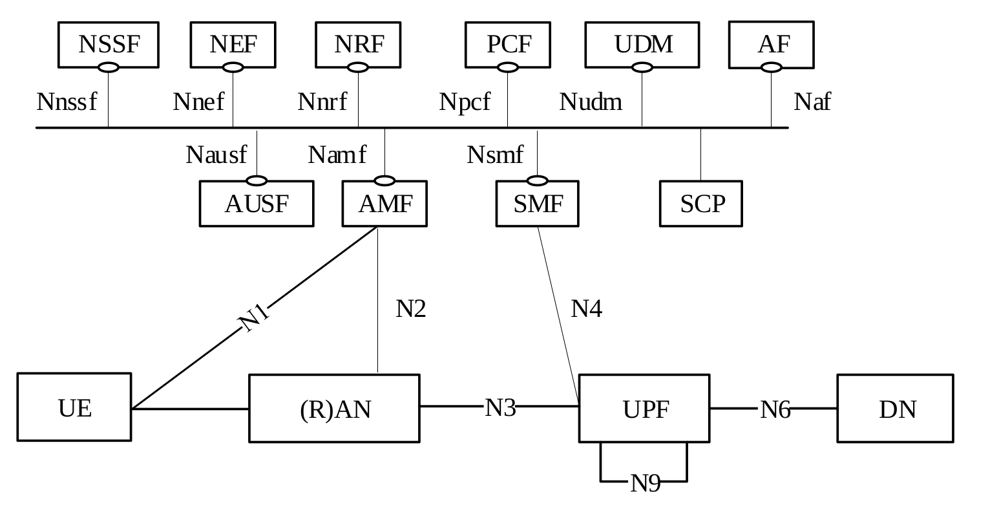

<!-- SPDX-License-Identifier: CC-BY-4.0 -->

<table style="border-collapse: collapse; border: none;">
  <tr style="border-collapse: collapse; border: none;">
    <td style="border-collapse: collapse; border: none;">
      <a href="http://www.openairinterface.org/">
         
         </img>
      </a>
    </td>
    <td style="border-collapse: collapse; border: none; vertical-align: center;">
      <b>OpenAirInterface LMF Feature Set</b>
    </td>
  </tr>
</table>

**Table of Contents**

1. [5GC Service Based Architecture](#1-5gc-service-based-architecture)
2. [OAI LMF Available Interfaces](#2-oai-lmf-available-interfaces)
3. [OAI LMF Feature List](#3-oai-lmf-feature-list)

# 1. 5GC Service Based Architecture #

# 2. OAI LMF Available Interfaces #

| **ID** | **Interface / API** | **Status** | **Comment** |
| ------ | ------------------- | ---------- |------------|
| 1 | NLs (LMF–AMF) | :heavy_check_mark: | NRPPa positioning messages are relayed through the AMF to and from gNBs. |
| 2 | Determine-location API | :heavy_check_mark: | Accepts a positioning request and returns the location result. |

# 3. OAI LMF Feature List #

| **ID** | **Feature** | **Status** | **3GPP specification / section** | **Comments** |
| ---- | ------------ | ---------- |-----------------------------------|--------------|
| 1 | Support a request for a single location received from a serving AMF for a target UE | :heavy_check_mark: | 3GPP TS 23.273, clause 4.3.8 | The implementation supports an external determine-location API request that initiates UL-TDoA positioning and returns the estimated location. |
| 2 | Support a request for periodic or triggered location received from a serving AMF for a target UE | :x: | 3GPP TS 23.273, clause 4.3.8 | |
| 3 | Determine type and number of position methods and procedures based on UE and PLMN capabilities, QoS, UE connectivity state per access type, LCS Client type, co-ordinate type and optionally service type | :x: | 3GPP TS 23.273, clause 4.3.8 | |
| 4 | Report UE location estimates directly to a GMLC for periodic or triggered location of a target UE | :x: | 3GPP TS 23.273, clause 4.3.8 | |
| 5 | Support cancelation of periodic or triggered location for a target UE | :x: | 3GPP TS 23.273, clause 4.3.8 | |
| 6 | Support the provision of broadcast assistance data to UEs via NG-RAN in ciphered or unciphered form and forward any ciphering keys to subscribed UEs via the AMF | :x: | 3GPP TS 23.273, clause 4.3.8 | |
| 7 | Support change of a serving LMF for periodic or triggered location reporting for a target UE | :x: | 3GPP TS 23.273, clause 4.3.8 | |
| 8 | Identify the target UE for a location request | :heavy_check_mark: | 3GPP TS 29.572, clause 6.1.6.2.2 (InputData) | The implementation identifies the target UE using its SUPI. Although the InputData model also exposes NCGI and Periodic Event Info, the current location procedure does not use those fields. |
| 9 | Support NRPPa protocol for positioning procedures | :heavy_check_mark: | NRPPa Release 17; 3GPP TS 38.455 v17.4.0, clauses 9.1.1 and 9.1.4 | The implemented procedures use the NRPPa Release 17 ASN.1 definitions and include TRP information, positioning information, positioning activation, and measurement request/response exchanges between the LMF and gNBs via the AMF. |
| 10 | Gather TRP information | :heavy_check_mark: | 3GPP TS 38.305, clause 8.13.3.2.1; TS 38.455, clauses 9.1.1.14–9.1.1.15 | The LMF requests information from connected gNBs and receives TRP ID, NG-RAN CGI, and geographical coordinates. |
| 11 | Obtain SRS positioning configuration from the serving gNB | :heavy_check_mark: | 3GPP TS 38.305, clause 8.13.3.4; TS 38.455, clauses 9.1.1.10–9.1.1.11 | The serving gNB returns its existing SRS configuration. SRS settings are predefined in gNB configuration; dynamic per-UE adjustment is not supported. |
| 12 | Activate positioning SRS on request | :warning: | 3GPP TS 38.305, clause 8.13.3.3a; TS 38.455, clauses 9.1.1.17–9.1.1.18 | UE SRS transmission is preactivated in the described OAI RAN and cannot be modified in real time; the activation response confirms the existing transmission. |
| 13 | Request UL-RToA measurements from participating gNBs/TRPs | :heavy_check_mark: | 3GPP TS 38.305, clause 8.13.3.4; TS 38.455, clauses 9.1.4.1–9.1.4.2 | Measurement requests are sent to connected gNBs. The LMF extracts the TRP ID and UL-RToA measurement from the responses. The gNB PHY estimates channel delay from uplink SRS. |
| 14 | Calculate UE position from measurements | :heavy_check_mark: | 3GPP TS 38.305, clause 8.13.3.4; TS 29.572, clause 6.1.6.2.3 (LocationData) | The LMF maps UL-RToA reports, computes TDoAs relative to the first collected UL-RToA measurement, and applies linear least-squares localization using the TDoAs and TRP positions. |

[1] Malik, Adeel; Ahadi, Mohsen; Kaltenberger, Florian; Warnke, Klaus; Nguyen, Tien Thinh; Bouknana, Nada; Thienot, Cedric; Onche, Godswill; Arora, Sagar,
"From concept to reality: 5G positioning with UL-TDoA in OpenAirInterface,"
NG-OPERA 2025, 3rd Workshop on Next-generation Open and Programmable Radio Access Networks, in conjunction with INFOCOM (IEEE International Conference on Computer Communications), 19 May 2025, London, UK
